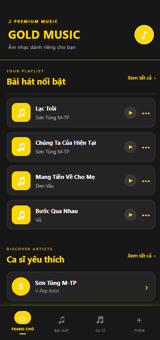
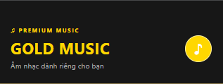
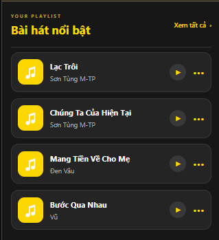
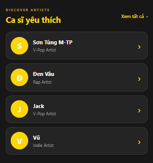
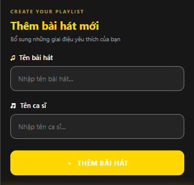
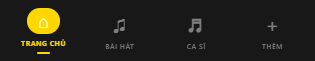

# MYAPP_V2

## 1. Link ứng dụng Expo

**Tên bài nộp:** MyApp_V2

**Link ứng dụng:** [MyApp_V2 – Expo Snack](https://snack.expo.dev/@voduyanh/myapp_v2?platform=web)

## 2. Các dòng code và hình ảnh giao diện các component

### 2.1. App.js
**Mã nguồn:** [App.js](App.js)

**Hình ảnh giao diện:**

### 2.2. Header
**Mã nguồn:** [Header.js](components/Header.js)

**Hình ảnh giao diện:**

### 2.3. SongList
**Mã nguồn:** [SongList.js](components/SongList.js)

**Hình ảnh giao diện:**

### 2.4. SongItem
**Mã nguồn:** [SongItem.js](components/SongItem.js)

**Hình ảnh giao diện:**

### 2.5. ArtistList
**Mã nguồn:** [ArtistList.js](components/ArtistList.js)

**Hình ảnh giao diện:**

### 2.6. AddSong
**Mã nguồn:** [AddSong.js](components/AddSong.js)

**Hình ảnh giao diện:**

### 2.7. TabBar
**Mã nguồn:** [TabBar.js](components/TabBar.js)

**Hình ảnh giao diện:**

